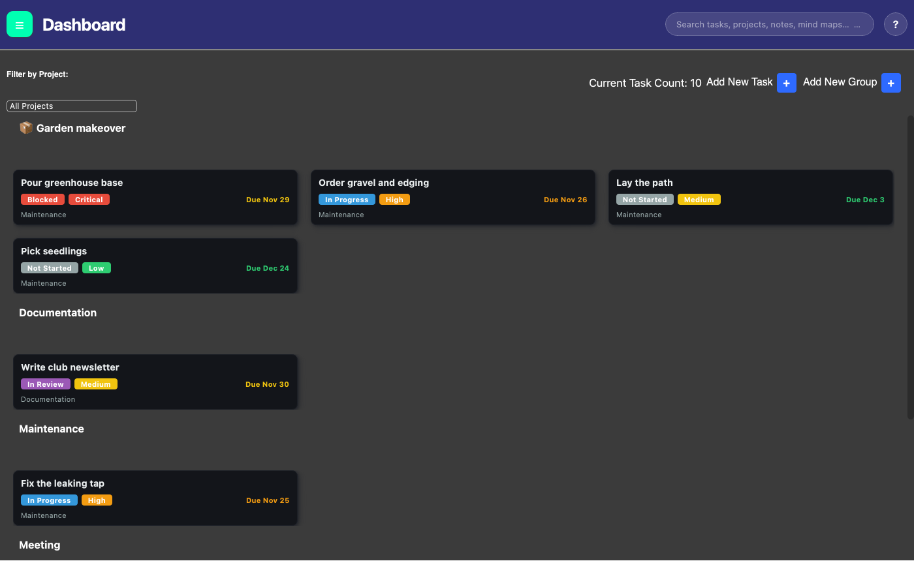
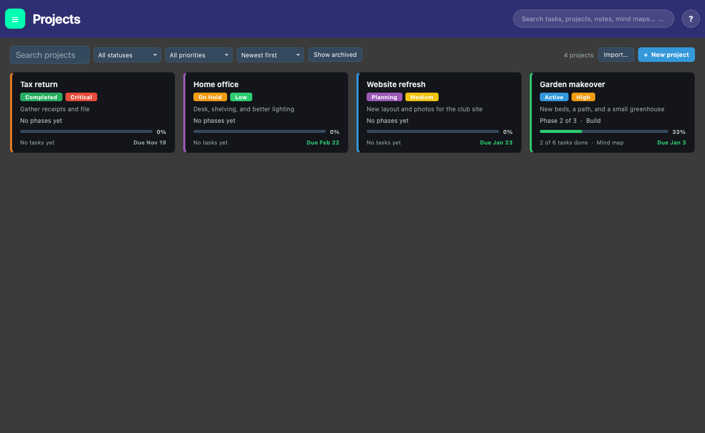
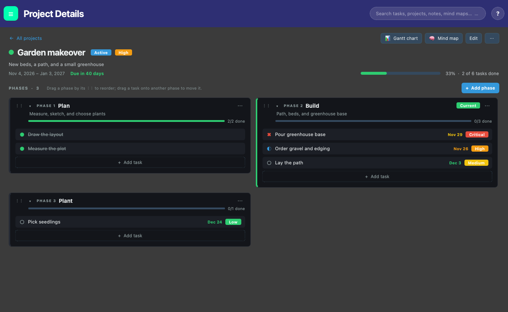
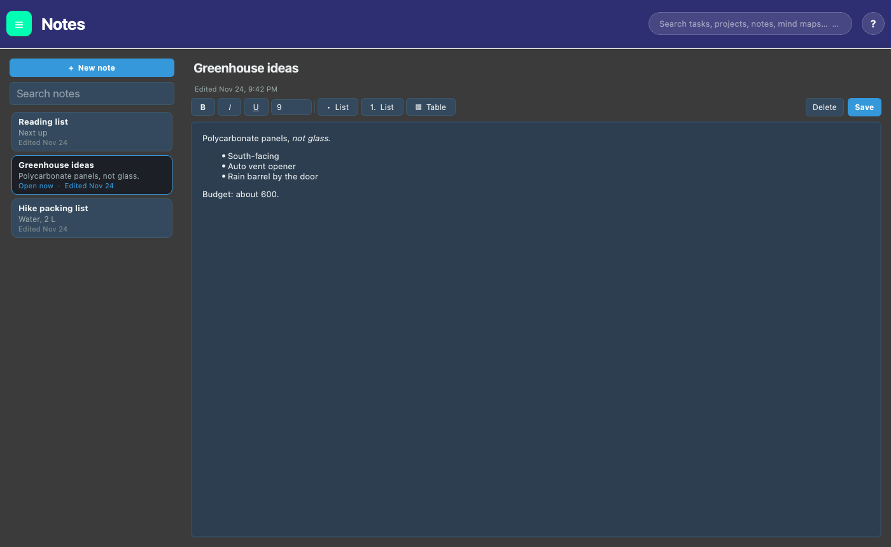
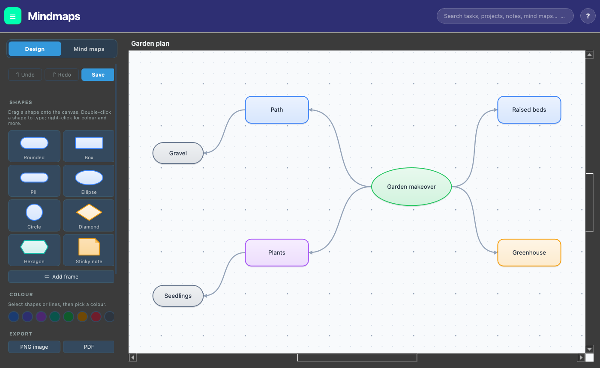

# Project Meridian

A desktop app for keeping your tasks, projects, notes, and mind maps in one place. It runs on Windows and macOS, works offline, and keeps everything on your own computer.



## What it does

- **Dashboard**: your tasks as cards, grouped by category or project. Each card shows the status, priority, and due date at a glance. Open a card for the full task: description, checklist, dates, hours, and people.
- **Planning**: drag tasks and projects onto a calendar, in daily, weekly, or monthly views.
- **Projects**: break bigger work into phases, and phases into tasks. Track progress, mark the current phase, and see the timeline on a Gantt chart.
- **Notes**: formatted notes (bold, lists, tables) with search, kept in a list with the most recently edited first.
- **Mind maps**: drag shapes onto a canvas, connect them, colour them, group them, and export the result as a PNG or PDF. A mind map can belong to a project.
- **Search everything** from the box at the top: tasks, projects, notes, and the text inside mind maps.
- **Undo almost anything** with Ctrl+Z, or with the Undo button in the notice that appears after a change.
- **Make it yours** in Settings: colours, task categories, interface size, and the screen it opens on.

| Projects | A project's phases |
|---|---|
|  |  |

| Notes | Mind maps |
|---|---|
|  |  |

## Getting started

There are no ready-made downloads yet. You can run the app from its source code, or build a standalone app that runs without Python.

### Run it from source

You need [Python](https://www.python.org/downloads/) 3.9 or newer.

```sh
git clone https://github.com/0nu-e0/Project-Meridian.git
cd Project-Meridian
python3 -m venv venv
source venv/bin/activate          # Windows: venv\Scripts\activate
pip install -r requirements.txt
python main.py
```

On later runs, activate the virtual environment and start the app with `python main.py`.

### Build a standalone app

Install the build tools once (with the virtual environment active):

```sh
pip install -r requirements-dev.txt
```

Then build on the system you want the app for:

| System | Command | Result |
|---|---|---|
| Windows | `build.bat` | `dist\ProjectMeridian\`: share the whole folder; run `ProjectMeridian.exe` |
| macOS | `./build.sh` | `dist/ProjectMeridian.app`: drag it into Applications |

The app isn't signed, so on another Mac it's blocked the first time it opens: right-click it and choose **Open**, or allow it in **System Settings → Privacy & Security**. Windows may show a SmartScreen warning: choose **More info → Run anyway**.

## Using it

Open the menu with the button at the top left to move between screens; the gear at the bottom of the menu opens Settings. Press **F1** (or the **?** button) at any time for the built-in guide. Hover over any button to see what it does.

A few things worth knowing:

- **Dashboard**: hover over a card for its details, click it to open it, and right-click it to archive it. Completed tasks archive themselves.
- **Planning**: drag a task or project from the left onto a day; drag it between days to move it, or back to the left to unschedule it.
- **Projects**: right-click a project's card to edit, export, archive, or delete it. In a project, drag a phase by its ⋮⋮ handle to reorder it, and drag a task onto another phase to move it there.
- **Gantt chart**: drag a bar to change its dates, or drag its ends to change its length.
- **Mind maps**: drag a shape from the **Design** tab onto the canvas and double-click it to type. Drag from a dot on a shape's edge to another shape to connect them, and drag a line to bend it. Your saved mind maps are in the **Mind maps** tab.

### Keyboard shortcuts

On a Mac, use ⌘ where these say Ctrl.

| Keys | Does |
|---|---|
| Ctrl+K or Ctrl+F | Search everything |
| Ctrl+N | New task |
| Ctrl+Z | Undo (on a mind map, undoes the map) |
| Ctrl+Y or Ctrl+Shift+Z | Redo |
| Ctrl+S | Save the mind map or note |
| Ctrl+B / Ctrl+I / Ctrl+U | Bold / italic / underline |
| Ctrl+G / Ctrl+Shift+G | Group / ungroup the selected shapes |
| Ctrl + / Ctrl − / Ctrl 0 | Zoom the mind map in / out / to actual size |
| Delete | Delete the selected shapes, lines, bend, or Gantt bar |
| Esc | Close search results; stop typing in a shape |
| F1 | The built-in guide |

## Your data

Tasks, projects, and settings are saved as soon as you change them; notes and mind maps are saved when you press **Save** (the app asks before you switch to another note or mind map, or close the app, with unsaved changes). Everything stays on your computer only, in readable JSON files:

| System | Folder |
|---|---|
| Windows | `%LOCALAPPDATA%\MeridianTasks` |
| macOS | `~/Library/Application Support/MeridianTasks` |
| Linux | `~/.local/share/MeridianTasks` |

**Settings → Data** shows the exact folder. To back up, or to move to another computer, copy that whole folder. If a file ever can't be read, the app sets it aside (with `.corrupt-` and the date added to its name) and tells you, rather than losing it.

## For developers

```sh
pip install -r requirements-dev.txt
ruff check .          # lint
python -m pytest      # tests (they use a temporary folder, never your real data)
```

On Windows, `check.bat` runs both.

The code is Python with [PyQt5](https://pypi.org/project/PyQt5/):

| Folder | Holds |
|---|---|
| `main.py` | The main window, the menu, and moving between screens |
| `ui/` | The screens and their widgets |
| `models/` | Tasks, projects, phases, notes, and mind maps |
| `utils/` | Saving and loading, settings, search, and undo |
| `resources/` | Colours, styles, and images |
| `tests/` | The test suite |

[DATAMANAGER_README.md](DATAMANAGER_README.md) explains how the app loads and shares its data.

## License

Project Meridian is released under the MIT License; the full text is at the top of every source file.
